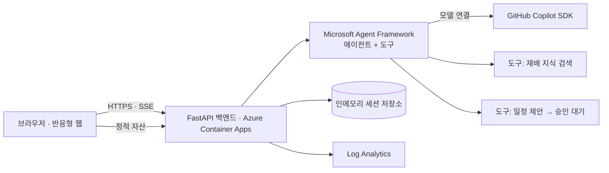

# TRD — 감잡아 기술 설계

> 상태: 초안 v0.2 (2시간 개발 기준). `[검증 필요]` 표시는 구현 시작 시 공식 문서로 확인할 항목이다.

## 1. 아키텍처 개요

P1: 날씨·작업 기록 도구, Cosmos DB, Key Vault, Application Insights.

## 2. 기술 스택 (2시간 P0 기준)
| 영역 | 선택 | 비고 |
|---|---|---|
| 백엔드 | Python 3.12 + FastAPI | 패키지 버전 고정 (`github-copilot-sdk`는 RC 버전) |
| 에이전트 | Microsoft Agent Framework (Python, `agent-framework-github-copilot`) | 필수 기술 |
| 모델 연결 | GitHub Copilot SDK (`github-copilot-sdk`) | 필수 기술; `GitHubCopilotAgent` 로 연결 확인(§2.1) |
| 프런트엔드 | 단일 페이지(정적 HTML/JS 또는 React+Vite), 백엔드가 서빙 | 단일 배포 단위, 같은 출처라 CORS 불필요 |
| 저장 | 인메모리, **replica 1개 고정** | 재시작 시 데이터 소실(데모 한정). P1: Cosmos DB |
| 호스팅 | Azure Container Apps + ACR + Log Analytics | 기본 도메인 사용 |
| 비밀 | Container Apps secret (`secretRef`) | 로그 노출 금지. P1: Key Vault + Managed Identity |
| IaC/배포 | `azd up` | GitHub Actions CI는 P2 |

불필요한 Azure 서비스는 추가하지 않는다.

## 2.1 연동 검증 결과 (2026-11-05, 로컬 spike)
검증 환경: Python 3.14, `agent-framework-github-copilot==2.1.1` (→ `agent-framework-core 1.24.0`, `github-copilot-sdk 1.0.29rc8`), Copilot CLI 1.0.105, `gh` 로그인 계정 인증.

| 항목 | 결과 |
|---|---|
| Python 지원 | ✅ `GitHubCopilotAgent(instructions=, tools=[python 함수], default_options={...})` |
| 모델 응답 | ✅ 비스트리밍 `await agent.run(...)` / 스트리밍 `agent.run(..., stream=True)` 모두 동작 |
| 커스텀 도구 호출 | ✅ `search_knowledge` 호출 후 도구 결과의 출처 ID를 인용해 답변 |
| 기본 권한 | ✅ 기본은 **거부** — `on_permission_request` 없이는 커스텀 도구도 실행되지 않음 |
| 권한 핸들러 | ✅ `request.kind == "custom-tool"` 이고 `tool_name` 이 허용 목록일 때만 `PermissionDecisionApproveOnce()`, 그 외 `PermissionDecisionUserNotAvailable()` 반환 (`from copilot.session import ...`) |
| 승인 훅 | `default_options` 에 `on_pre_tool_use`, `on_function_approval` 도 존재 (쓰기 도구 승인에 활용 가능) |

**배포 시 남은 확인 사항 (Azure 컨테이너에서 검증 필요)**
- Python 패키지에 Copilot CLI 바이너리는 포함되지 않음 → 컨테이너에 CLI 설치(`@github/copilot`) 필요. 공식 사전 빌드 Docker 이미지는 없음.
- 인증: 로컬은 로그인 자격증명 사용. 서버에서는 `CopilotClient(github_token=..., use_logged_in_user=False)` 또는 `COPILOT_GITHUB_TOKEN` 환경변수 사용. 지원 토큰: `gho_`, `ghu_`, `github_pat_`(fine-grained); classic `ghp_` 미지원. Copilot 구독 필요.
- 검증 환경(Python 3.14)과 목표(Python 3.12)가 다르므로 컨테이너에서 패키지 버전을 고정해 재확인한다.
- 토큰은 Container Apps secret으로 주입(P1: Key Vault). 공개 데모에서 한 계정의 구독으로 호출하는 것이 허용되는지와 과금(프리미엄 요청 사용량)은 대회 운영진에 확인 `[검증 필요]`. fine-grained PAT는 Copilot 권한·만료일 확인.
- 쓰기성 도구는 전부 `propose_*` 로 두고 서버 승인 API에서만 저장하는 설계 유지.

## 3. 에이전트 설계
**단일 "농사 도우미" 에이전트 + 도구 호출**로 시작한다 (분리는 P2).

| 도구 | 유형 | 우선순위 | 설명 |
|---|---|:---:|---|
| `search_knowledge(query)` | 읽기 | P0 | `data/knowledge/` 큐레이션 문서에서 검색, 출처 메타데이터 반환 |
| `propose_calendar_event(...)` | 쓰기(보류) | P0 | 저장하지 않고 **승인 대기 제안** 생성 |
| `get_weather(location, days)` | 읽기 | P1 | 예보 조회; 실패 시 명시적 오류 반환 |
| `get_farm_context(farm_id)` | 읽기 | P1 | 과원 정보 + 최근 작업 기록 |

- 컨텍스트에 현재 날짜(Asia/Seoul)와 계절을 포함한다 (현재 11월: 수확·곶감 시기 중심으로 지식 큐레이션).
- 에이전트가 제안한 일정은 API의 `POST /api/proposals/{id}/approve` 에서만 저장 (에이전트는 직접 저장 불가). 승인은 멱등·원자적(중복/동시 승인 시 일정 1개), 제안은 발급 세션만 승인 가능.
- 컨텍스트: 시스템 프롬프트(정책) + 과원 컨텍스트 + 최근 대화 N턴. 도구 결과는 "데이터" 블록으로 구분.
- 스트리밍: **상태/도구 호출 이벤트만** SSE로 전달하고, 답변 본문은 서버에서 정책 검사(농약 용량, 지어낸 측정값 등)를 통과한 뒤 최종 답변으로 한 번 전송한다. 목표 지연은 "첫 상태 이벤트 < 3초".
- 출력 구조: 오늘의 할 일은 JSON 스키마(제목, 이유, 출처 ID[])로 검증. 출처 ID는 요청 단위로 `search_knowledge` 가 실제 반환한 ID만 허용(요청별 컨텍스트에 기록, 동시 요청 간 섞임 방지). 지식 문서는 소수의 검토된 항목(작업, 근거 문장)으로 구조화해 모델은 그 범위 안에서 선택·설명한다. JSON 파싱 실패 시 1회 재시도 후 "확인 필요"로 표시. 수치형 신뢰도 대신 "근거 있음/확인 필요"로 표시.
- 오늘의 할 일은 (과원, 날짜) 기준 인메모리 캐시로 GET 때마다 LLM을 호출하지 않는다.
- 도구는 허용 목록만 제공하고 셸·파일·URL 권한은 명시적으로 거부.
- 연동 spike(첫 25분): 두 패키지 버전 고정, Azure 컨테이너에서 실제 모델 응답·도구 호출 확인. 이 전에 폴백을 성공으로 간주하지 않는다.

## 4. 지식 데이터
- 청도군 농업기술센터, 농촌진흥청(농사로) 등 공개 자료를 요약·정리해 `data/knowledge/*.md` 5~8개로 저장 (프런트매터: `source_title`, `source_url`, `retrieved_at`). 11월 기준 수확·곶감 준비 중심.
- 해커톤 범위에서는 벡터 DB 없이 키워드/섹션 검색으로 시작, 필요 시 임베딩 추가.
- 출처 없는 항목은 에이전트가 사실로 단정하지 못하도록 `확인 필요`로 반환.

## 5. API
모든 `/api/*` 요청은 클라이언트가 생성해 localStorage에 보관한 UUID를 `X-Session-Id` 헤더로 보내며(쿠키·CSRF 불필요), 서버는 세션에 바인딩해 조회·승인한다.

| 메서드 | 경로 | 우선순위 | 설명 |
|---|---|:---:|---|
| GET | `/api/health` | P0 | 상태 확인 |
| GET | `/api/farms/demo` | P0 | 데모 과원 (인증 불필요) |
| GET | `/api/farms/{id}/today` | P0 | 오늘의 할 일 (캐시) |
| POST | `/api/farms/{id}/chat` | P0 | 채팅 (SSE 상태 스트림 + 최종 답변) |
| GET | `/api/farms/{id}/calendar` | P0 | 일정 조회 |
| POST | `/api/proposals/{id}/approve` / `reject` | P0 | 제안 승인/거절 (세션 소유 확인) |
| POST | `/api/farms` | P1 | 과원 등록 |
| GET/POST | `/api/farms/{id}/logs` | P1 | 작업·수확 기록 |
| PATCH/DELETE | `/api/farms/{id}/calendar/{eventId}` | P2 | 일정 수정/삭제 |

## 6. 데이터 모델 (P0 인메모리 / P1 Cosmos DB 파티션 키 `farmId`)
- 모든 문서는 `farmId` 와 세션 식별자를 가진다 (`Farm` 은 `farmId = id`). 세션은 TTL 후 만료.
- `Farm`: id, name, cultivar(`청도반시`), plantedYear, region(읍·면), areaM2, isDemo
- `LogEntry` (P1): id, farmId, type(work|symptom|harvest), date, note, amount?
- `CalendarEvent`: id, farmId, title, date, reason, sources[]
- `Proposal`: id, farmId, sessionId, event, status(pending|approved|rejected), createdAt, ttl

## 7. 보안 및 책임 있는 AI
- 입력 길이 제한, 속도 제한(IP/세션, 인메모리 카운터), 보안 헤더. (같은 출처 서빙이라 CORS 불필요)
- 프롬프트 인젝션: 외부 텍스트(지식, 사용자 메모)는 인용 블록으로 전달, 시스템 정책이 우선함을 명시, 도구 인자 서버측 검증.
- 비밀: Container Apps secret, `.env`는 `.gitignore`.
- PII 최소화, 로그에 사용자 메모 원문 과다 기록 금지.
- 데모 기본 데이터는 읽기 전용, 쓰기(제안·승인·일정)는 **방문자별 임시 세션**에 격리. 모든 조회·승인을 서버에서 세션에 바인딩하고 제안 만료(ttl)를 둔다. 쿠키 사용 시 SameSite/CSRF 방어.
- 비용 보호: 요청 타임아웃, 동시 호출·재시도 상한, 세션/IP 속도 제한, Azure 예산 알림. 모델 사용 과금은 Azure 비용과 별개일 수 있음 `[검증 필요]`.
- 에이전트가 농약 제품·용량을 말하지 않도록 정책 + 출력 검사(키워드/패턴) 적용.

## 8. 오류 처리·성능
- 모델 장애 시 사용자에게 명확한 상태 메시지와 재시도 버튼(재시도 횟수 상한). 모델 호출은 타임아웃·지수 백오프(상한). (정적 캘린더 폴백은 제외)
- 오늘의 할 일 결과는 (과원, 날짜) 기준 인메모리 캐시. 날짜는 Asia/Seoul 기준.

## 9. 배포
- P0: Container Apps + ACR + Log Analytics, replica 1개 고정. `azd up` 으로 프로비저닝+배포. Dockerfile에 Python 3.12 + Node + `@github/copilot` CLI 포함.
- P1: Cosmos DB, Key Vault, Managed Identity, Application Insights, Bicep 정식화. P2: GitHub Actions.
- 제출 URL은 `*.azurecontainerapps.io` 기본 도메인.
- 비용 상한: 팀당 Azure 50,000원 이내가 되도록 최소 SKU/serverless 사용.

## 10. 저장소 구조 (제안)
```
/references (AGENTS.md, PRD.md, TRD.md, TDD.md 초안; 제출 시 PRD.md/TRD.md는 저장소 루트에 필요)  /README.md
/backend    (app/, agents/, tools/, tests/)
/frontend   (src/, tests/)
/data/knowledge
/infra      (main.bicep, azure.yaml)
```

## 11. 위험과 대응
| 위험 | 대응 |
|---|---|
| SDK/프레임워크 연동 방식 불확실 | 시작 25분 내 Azure에서 최소 에이전트 spike로 확인, 실패 시 대안 경로를 PRD에 기록 |
| 지식 자료 부정확 | 출처 표기 + 확인 필요 플래그, 큐레이션 범위 축소(5~8개) |
| 시간 부족(2시간) | P0만 구현, P1/P2 제외 |
| 심사 접근 불가 | 로그인 없는 데모 경로 상시 제공 |
