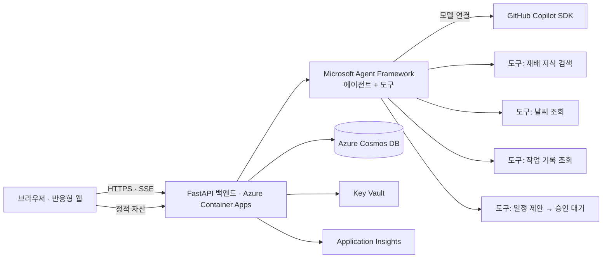

# TRD — 감잡아 기술 설계

> 상태: 초안 v0.1. `[검증 필요]` 표시는 구현 시작 시 공식 문서로 확인할 항목이다.

## 1. 아키텍처 개요


## 2. 기술 스택 (제안)
| 영역 | 선택 | 비고 |
|---|---|---|
| 백엔드 | Python 3.12 + FastAPI | Copilot SDK·Agent Framework 모두 Python 지원 `[검증 필요]` |
| 에이전트 | Microsoft Agent Framework (Python) | 필수 기술 |
| 모델 연결 | GitHub Copilot SDK | 필수 기술; Agent Framework와의 연결 방식 `[검증 필요]` |
| 프런트엔드 | React + Vite + TypeScript (빌드 산출물을 백엔드가 서빙) | 단일 배포 단위 |
| DB | Azure Cosmos DB (NoSQL, serverless) | 과원·기록·일정 |
| 호스팅 | Azure Container Apps (`*.azurecontainerapps.io`) | 기본 도메인 사용 |
| 비밀 | Key Vault + Managed Identity | 코드/이슈에 비밀 금지 |
| 관측성 | Application Insights | 요청·도구 호출·오류 추적 |
| IaC/배포 | Bicep + `azd` , GitHub Actions | 반복 가능한 배포 |

불필요한 Azure 서비스는 추가하지 않는다 (Computer Vision 등은 P2 이후 필요 시).

## 3. 에이전트 설계
**단일 "농사 도우미" 에이전트 + 도구 호출**로 시작하고, 시간이 남으면 계획/검증 에이전트로 분리한다.

| 도구 | 유형 | 설명 |
|---|---|---|
| `search_knowledge(query)` | 읽기 | `data/knowledge/` 큐레이션 문서에서 검색, 출처 메타데이터 반환 |
| `get_weather(location, days)` | 읽기 | 예보 조회; 실패 시 명시적 오류 반환 |
| `get_farm_context(farm_id)` | 읽기 | 과원 정보 + 최근 작업 기록 |
| `propose_calendar_event(...)` | 쓰기(보류) | 저장하지 않고 **승인 대기 제안** 생성 |

- 에이전트가 제안한 일정은 API의 `POST /api/proposals/{id}/approve` 에서만 저장 (에이전트는 직접 저장 불가). 승인은 멱등(중복 승인 시 일정 1개).
- 컨텍스트: 시스템 프롬프트(정책) + 과원 컨텍스트 + 최근 대화 N턴. 도구 결과는 "데이터" 블록으로 구분.
- 스트리밍: 진행 상태·도구 호출 이벤트를 SSE로 전달. 답변 본문은 서버에서 정책 검사(농약 용량, 지어낸 측정값 등)를 통과한 뒤 표시한다 (사후 차단으로는 이미 노출되므로).
- 출력 구조: 오늘의 할 일은 JSON 스키마(제목, 이유, 출처 ID[])로 검증. 출처 ID는 `search_knowledge` 가 실제 반환한 ID만 허용(서버 검증). 수치형 신뢰도 대신 "근거 있음/확인 필요"로 표시.
- 도구는 허용 목록만 제공하고 셸·파일·URL 권한은 명시적으로 거부 (설정 변경 시에도 유지되는지 테스트).
- 연동 spike(첫 30분): 두 패키지 버전 고정, Azure 컨테이너에서 실제 모델 응답·도구 호출·스트리밍 확인. 이 전에 폴백을 성공으로 간주하지 않는다.

## 4. 지식 데이터
- 청도군 농업기술센터, 농촌진흥청(농사로) 등 공개 자료를 요약·정리해 `data/knowledge/*.md`로 저장 (프런트매터: `source_title`, `source_url`, `retrieved_at`).
- 해커톤 범위에서는 벡터 DB 없이 키워드/섹션 검색으로 시작, 필요 시 임베딩 추가.
- 출처 없는 항목은 에이전트가 사실로 단정하지 못하도록 `확인 필요`로 반환.

## 5. API
| 메서드 | 경로 | 설명 |
|---|---|---|
| GET | `/api/health` | 상태 확인 |
| POST | `/api/farms` | 과원 등록 |
| GET | `/api/farms/demo` | 데모 과원 (인증 불필요) |
| GET | `/api/farms/{id}/today` | 오늘의 할 일 생성 |
| POST | `/api/farms/{id}/chat` | 채팅 (SSE 스트림) |
| GET/POST | `/api/farms/{id}/logs` | 작업·수확 기록 |
| GET | `/api/farms/{id}/calendar` | 일정 조회 |
| POST | `/api/proposals/{id}/approve` / `reject` | 제안 승인/거절 |

## 6. 데이터 모델 (Cosmos DB, 파티션 키 `farmId`)
- 모든 문서는 `farmId` 와 세션 식별자를 가진다 (`Farm` 은 `farmId = id`). 캐시는 기록·승인 시 무효화.
- `Farm`: id, name, cultivar(`청도반시`), plantedYear, region(읍·면), areaM2, isDemo
- `LogEntry`: id, farmId, type(work|symptom|harvest), date, note, amount?
- `CalendarEvent`: id, farmId, title, date, reason, sources[]
- `Proposal`: id, farmId, event, status(pending|approved|rejected), createdAt, ttl

## 7. 보안 및 책임 있는 AI
- 입력 길이 제한, 속도 제한(IP/세션), CORS 제한, 보안 헤더.
- 프롬프트 인젝션: 외부 텍스트(지식, 사용자 메모)는 인용 블록으로 전달, 시스템 정책이 우선함을 명시, 도구 인자 서버측 검증.
- 비밀: Managed Identity + Key Vault, `.env`는 `.gitignore`.
- PII 최소화, 로그에 사용자 메모 원문 과다 기록 금지.
- 데모 기본 데이터는 읽기 전용, 쓰기(제안·승인·일정)는 **방문자별 임시 세션**에 격리. 모든 조회·승인을 서버에서 세션에 바인딩하고 제안 만료(ttl)를 둔다. 쿠키 사용 시 SameSite/CSRF 방어.
- 비용 보호: 요청 타임아웃, 동시 호출·재시도 상한, 세션/IP 속도 제한, Azure 예산 알림. 모델 사용 과금은 Azure 비용과 별개일 수 있음 `[검증 필요]`.
- 에이전트가 농약 제품·용량을 말하지 않도록 정책 + 출력 검사(키워드/패턴) 적용.

## 8. 오류 처리·성능
- 모델/날씨 장애 시 사용자에게 명확한 상태 메시지, 재시도 버튼, 지식 기반 정적 캘린더로 대체.
- 도구 호출 타임아웃, 모델 호출 재시도(지수 백오프, 상한).
- 오늘의 할 일 결과는 (과원, 날짜) 기준 단기 캐시.

## 9. 배포
- `infra/` Bicep: Container Apps 환경, ACR, Cosmos DB, Key Vault, App Insights, Managed Identity.
- `azd up` 으로 프로비저닝+배포 (P0). GitHub Actions 자동 배포는 P1.
- 제출 URL은 `*.azurecontainerapps.io` 기본 도메인.
- 비용 상한: 팀당 Azure 50,000원 이내가 되도록 최소 SKU/serverless 사용.

## 10. 저장소 구조 (제안)
```
/AGENTS.md  /PRD.md  /TRD.md  /TDD.md  /README.md
/backend    (app/, agents/, tools/, tests/)
/frontend   (src/, tests/)
/data/knowledge
/infra      (main.bicep, azure.yaml)
```

## 11. 위험과 대응
| 위험 | 대응 |
|---|---|
| SDK/프레임워크 연동 방식 불확실 | 시작 30분 내 최소 에이전트 spike로 확인, 실패 시 대안 경로를 PRD에 기록 |
| 지식 자료 부정확 | 출처 표기 + 확인 필요 플래그, 큐레이션 범위 축소 |
| 시간 부족 | P0 우선, P2(사진) 제외 가능 |
| 심사 접근 불가 | 로그인 없는 데모 경로 상시 제공 |
